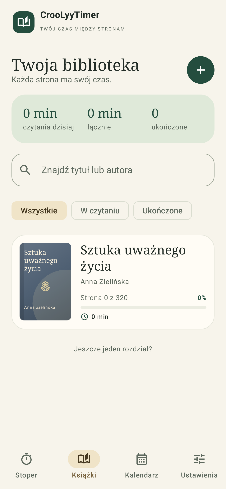
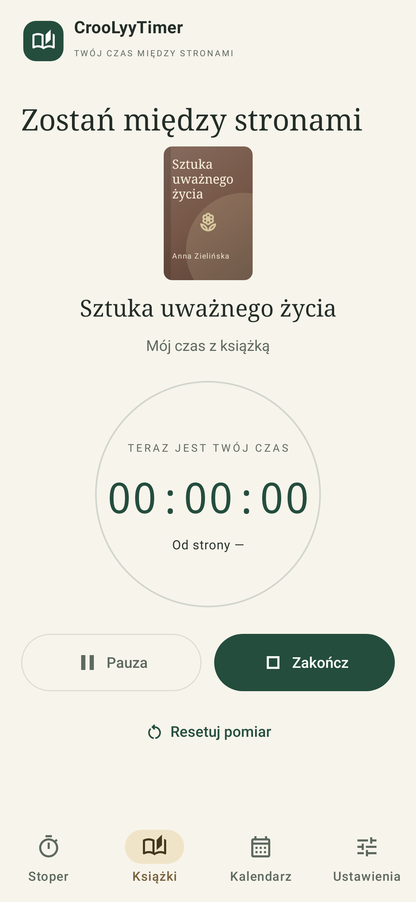
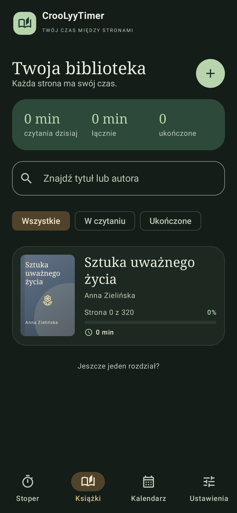
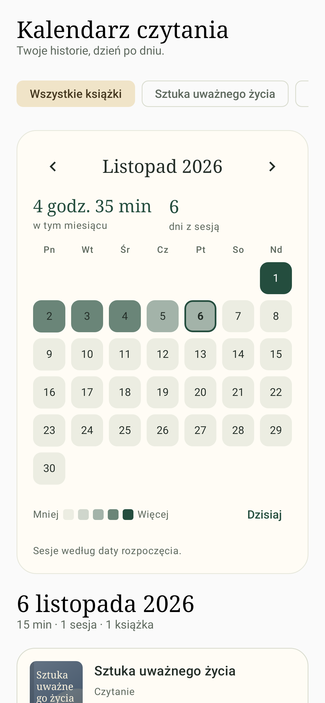
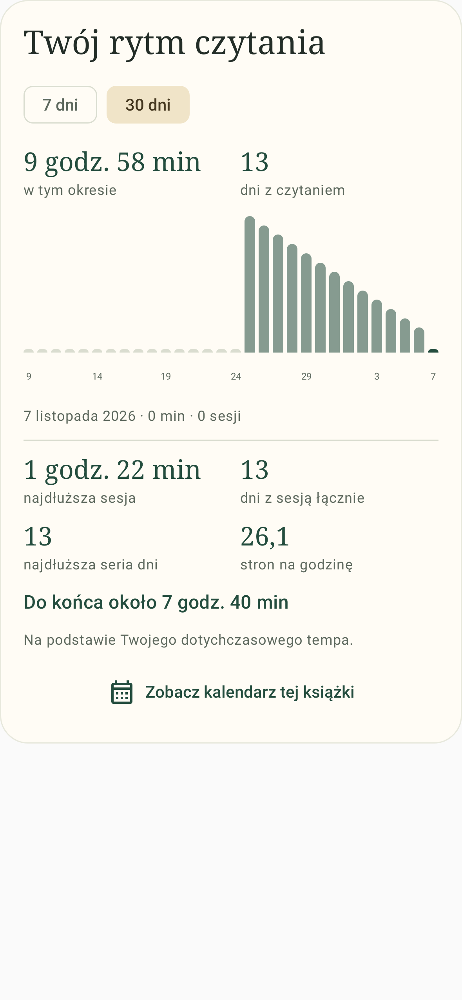

<p align="center"></p>

Natywna aplikacja Android do spokojnego mierzenia czasu czytania. Kotlin, Jetpack Compose,
Material 3, Room, DataStore, Coroutines/Flow i Navigation Compose. Cały interfejs po polsku.
Bez reklam, analityki i obowiązkowego konta. Android **8.0+ (API 26)**.

**Publiczne repozytorium, wszystkie prawa zastrzeżone.** Kod i marka należą do CrooLyyCheck.
Ponowne wykorzystanie kodu, modyfikowanie, rozpowszechnianie i zastosowania komercyjne wymagają
uprzedniej pisemnej zgody właściciela, z wyjątkami opisanymi w [LICENSE](LICENSE).
Oficjalne, niezmienione APK można pobierać i używać osobiście, niekomercyjnie.
Regulamin GitHuba nadal umożliwia przeglądanie i forki w ramach platformy;
projekt nie jest udostępniany na licencji open source.

<p align="center">
  
  
  
</p>

Rzeczywiste komponenty Android wyrenderowane w testach Robolectric; przykładowa biblioteka nie jest częścią APK.

<p align="center">
  
  
</p>

## Co działa

- Biblioteka: dodawanie, edycja, wyszukiwanie, ukończenie i usuwanie książek.
- Okładki z plików/galerii, aparatu i wyszukiwarki Open Library: propozycje po tytule, wybór i zapis lokalny.
- Dowolna liczba nazwanych stoperów na książkę, sumowana historia i statystyki.
- Wykresy 7/30 dni, tempo, serie dni, najdłuższa sesja i szacowany czas do końca książki.
- Kalendarz z miesięczną heatmapą, filtrem książki i sesjami po kliknięciu daty.
- Jeden aktywny pomiar w całej aplikacji. Start, pauza, wznowienie, koniec i reset.
- Dwa niezależne wymagania strony przed/po sesji, domyślnie włączone. Strony **0 i 1 są poprawne**.
- Ostrzeżenie przy cofnięciu strony, późniejsza edycja stron i czasu sesji.
- Trwały stoper z zegarem monotonicznym, odtwarzanie po zamknięciu procesu i obsługa restartu telefonu.
- Osobny zwykły stoper, domyślnie zablokowany, z własną historią.
- Systemowe powiadomienie z licznikiem, pauzą i wznowieniem; prośba o Live Update na Androidzie 16+.
  Android 17+: duży czas w treści karty, wspólny pomiar dla karty i pastylki systemowej.
- Sprawdzanie nowych wersji z GitHuba, pobieranie i instalacja przez system Android, bez sklepu.
- Pełne kopie ZIP, opcjonalnie AES-256, walidowane i przywracane transakcyjnie.
- Rzeczywista integracja Google Drive `appDataFolder`, **wymagająca konfiguracji OAuth właściciela**.
- Jasny/ciemny/systemowy motyw i opcjonalne niewygaszanie ekranu w aplikacji.

## Android Studio i uruchomienie

Instrukcje budowania są przeznaczone dla właściciela i osób mających odpowiednią zgodę zgodnie z licencją.

1. Sklonuj repo: `gh repo clone CrooLyyCheck/croolyytimer`.
2. Otwórz katalog projektu w Android Studio obsługującym AGP 9.2. Użyj JDK 21
   (wbudowany JDK Android Studio też może spełniać wymagania).
3. Zainstaluj Android SDK Platform 37.0 i zaakceptuj licencje SDK w SDK Managerze.
4. Pozwól Android Studio ustawić `local.properties` z lokalnym `sdk.dir`.
5. Poczekaj na Gradle Sync. Wybierz moduł `app` oraz telefon/emulator API 26+ i **Run**.

Projekt zawiera Gradle Wrapper 9.4.1. Pierwszy build potrzebuje internetu do pobrania bibliotek;
biblioteka i pomiary działają bez internetu. Zależności są przypięte do kompatybilnego,
stabilnego zestawu, bez wersji alpha/beta i bez dynamicznych `+`.

### APK debug

```powershell
.\gradlew.bat assembleDebug
```

Linux/macOS: `./gradlew assembleDebug`. Wynik: `app/build/outputs/apk/debug/app-debug.apk`.
Instalacja: `adb install -r app/build/outputs/apk/debug/app-debug.apk`.
Gotowe APK można pobrać z [oficjalnych wydań](https://github.com/CrooLyyCheck/croolyytimer/releases)
bez konta GitHub, na warunkach [licencji](LICENSE).

### Podpisany release

Utwórz własny klucz w **Android Studio → Build → Generate Signed App Bundle or APK**
albo `keytool -genkeypair` (RSA 3072+, SHA256withRSA). Zachowaj keystore i hasła poza repo,
w menedżerze haseł i bezpiecznej kopii. Ten sam klucz jest wymagany do kolejnych aktualizacji.

Konfiguracja Gradle odczytuje `CROOLYY_KEYSTORE`, `CROOLYY_STORE_PASSWORD`,
`CROOLYY_KEY_ALIAS` i `CROOLYY_KEY_PASSWORD` z lokalnego środowiska. Ustaw je bez
zapisywania sekretów w historii poleceń, np. przez menedżer sekretów albo skrypt z `Read-Host -AsSecureString`.
Następnie uruchom:

```powershell
.\gradlew.bat assembleRelease
```

Wynik: `app/build/outputs/apk/release/`. Bez zmiennych podpisu powstaje
`app-release-unsigned.apk`; nie jest to instalowalny podpisany release. Debug jest podpisany
automatycznie. Testy i kompilację uruchamia się lokalnie; projekt nie używa GitHub Actions.

## Odblokowanie zwykłego timera

Domyślnie pierwszy ekran jest zablokowany. Timery książek zawsze pozostają dostępne.
W Ustawieniach hasło **`takchce`** daje dokładnie **168 godzin od wpisania**. Ponowne wpisanie
ustawia nowe 168 godzin od tej chwili. Termin wygaśnięcia jest widoczny w interfejsie.

Stan jest zapisany w DataStore i przetrwa zamknięcie procesu oraz restart. Podczas jednego
uruchomienia telefonu czas dostępu uwzględnia monotoniczny zegar i trwały znacznik największego
zaobserwowanego czasu. Cofnięcie zegara nie wydłuża dostępu; znaczne cofnięcie przy restarcie
unieważnia tymczasowy dostęp. Przestawienie zegara w przyszłość może skrócić dostęp.
Po wygaśnięciu można zakończyć już aktywny zwykły pomiar, a wznowienie wymaga odblokowania.

### Hasło administratora i jego zmiana

**Najprościej na Windows:** otwórz PowerShell w katalogu repo i uruchom:

```powershell
.\tools\set-admin-password.ps1
```

Wpisz dwa razy własne hasło (minimum 20 znaków; nie będzie widoczne). Skrypt zapisze
wyłącznie weryfikator w **`config/admin-verifier.json`**, zatwierdzi ten plik i wyśle na `main`.
Potrzebne są Python 3 i dostęp Git do repozytorium. **Nie trzeba przebudowywać ani instalować APK.**
Opcja `-NoPush` zapisuje tylko plik lokalny, do samodzielnego przeglądu i publikacji.

Od wersji **1.2** aplikacja pobiera aktualny weryfikator z repo przy każdej próbie trwałego
odblokowania, a hasło sprawdza lokalnie. Ta czynność wymaga internetu; hasło nie jest wysyłane
do GitHuba. Nie używamy starego weryfikatora z cache. Po poprawnym wpisaniu odblokowanie
pozostaje trwałe także offline, po restarcie telefonu i po aktualizacji APK.
Zmiana hasła nie cofa już przyznanych trwałych odblokowań.

Opcja `.\tools\set-admin-password.ps1 -Generate` losuje hasło i przekazuje je do schowka,
żeby zapisać je w menedżerze haseł. Nie wpisuj hasła w poleceniu ani w czacie.

Ręczny wariant i szczegóły techniczne:

W repo jest wyłącznie weryfikator **Argon2id v19, 64 MiB, 3 iteracje, 1 wątek, losowa sól 16 B**.
Sól i hash są publiczne, a hasło pozostaje u właściciela. W APK 1.2+ nie ma tego weryfikatora.
Ręcznie można utworzyć plik poniższymi poleceniami, po czym zatwierdzić i wysłać go do repo:

```powershell
python -m pip install -r tools/requirements.txt
python tools/set_admin_password.py
```

Skrypt pyta bez echa o własne hasło (min. 20 znaków) i potwierdzenie. Zalecamy losowe hasło
z menedżera haseł. Opcja `python tools/set_admin_password.py --generate` generuje długie losowe
hasło i **kopiuje je do schowka**, po czym wymaga potwierdzenia zapisania go w menedżerze haseł
i czyści schowek. Ten tryb wymaga interaktywnego terminala i systemowego narzędzia schowka
(`clip.exe`, `pbcopy`, `wl-copy` lub `xclip`). Hasło nie jest wypisywane do terminala ani logów.
Skrypt nie przyjmuje hasła jako argumentu, nie zapisuje go do pliku i nie wypisuje w trybie własnego hasła.

Po 5 błędnych hasłach działa trwały cooldown od 30 s do 1 godziny. Błąd połączenia z repo
nie jest liczony jako błędne hasło. Starsze APK 1.0/1.1 trzeba jednorazowo zaktualizować do 1.2;
korzystały z weryfikatora wbudowanego podczas kompilacji.

Blokada jest kontrolą funkcji. Całkowicie offline klient nie gwarantuje odporności na zmodyfikowane
APK, root, podmianę lokalnych danych czy reinstalację. Nie zabezpiecza danych wrażliwych.

## Timery i odzyskiwanie

Pomiar to suma zakończonych odcinków i różnicy `SystemClock.elapsedRealtime()` od ostatniego
wznowienia. Nie jest licznikiem dodającym sekundę w tle. Stan trafia do Room przy każdej zmianie,
co 10 s w widocznej aplikacji i przy przejściu w tło. Wygaszenie ekranu, blokada telefonu,
zmiana orientacji i zabicie procesu nie przerywają pomiaru w obrębie jednego startu urządzenia.

Po restarcie urządzenia sesja wraca **wstrzymana**, z czasem do ostatniego checkpointu.
Nie doliczamy arbitralnie czasu wyłączonego telefonu. Część od ostatniego zapisu do restartu
może wymagać ręcznej korekty w historii sesji; aplikacja mówi o tym wprost. Import aktywnej
sesji z ZIP-a również zawsze przywraca ją jako wstrzymaną. Nie tworzy drugiej sesji.

Nie ma usługi foreground ani cyklicznego budzenia procesora w tle. Systemowy chronometr
w powiadomieniu odświeża czas sam. Aplikacja nie żąda uprawnień do kamery ani całej pamięci;
zdjęcie robi zewnętrzna aplikacja aparatu przez FileProvider, pliki wybiera systemowy selektor.
Uprawnienia: internet do okładek, aktualizacji, hasła administratora i opcjonalnego Drive;
powiadomienia (zgoda od Androida 13), normalne uprawnienie do promowanych powiadomień
oraz żądanie instalacji aktualizacji APK za zgodą systemową. Odmowa nie blokuje pomiaru.
O wyglądzie pastylki/Now Bar decyduje Android i producent; szczegóły: [SYSTEM_TIMER.md](docs/SYSTEM_TIMER.md).

## Wyszukiwanie okładek

W formularzu książki wpisz tytuł i wybierz **Znajdź okładkę w internecie → Szukaj okładek**.
Wybierz jedną z maksymalnie 12 propozycji, a następnie zapisz książkę. Można zmienić tytuł
wyszukiwania niezależnie od tytułu książki, np. na oryginalny. Nie potrzeba serwera, konta ani klucza API.
Okładka jest pobierana z [Open Library](https://openlibrary.org), optymalizowana i kopiowana
do prywatnego magazynu. Po zapisie działa offline i trafia do kopii ZIP.

Wyszukiwanie następuje wyłącznie po naciśnięciu przycisku; wpisany tytuł trafia do Open Library.
Zapytania są buforowane i ograniczone do jednego na ok. sekundę, podglądy pobierane po trzy.
JSON ma limit 2 MiB, obraz 10 MiB, połączenia wyłącznie HTTPS do hostów Open Library.
Katalog nie ma każdej książki/wydania: można użyć pliku, aparatu lub okładki zastępczej.

## Wykresy i kalendarz

Szczegóły książki pokazują wykres 7/30 dni, statystyki sesji, ważone tempo czytania
i szacowany czas do końca. Brakujące lub cofnięte numery stron nie tworzą sztucznego tempa.
Kalendarz ma filtr książki, przełączanie miesięcy i klikalną heatmapę. Pod nią zobaczysz
konkretne książki, nazwy pomiarów, czas i zakres stron z wybranego dnia.
Sesja jest przypisana do lokalnej daty rozpoczęcia; po przekroczeniu północy nie dzielimy
czasu na dni, ponieważ historia nie zawiera wszystkich odcinków pauz.

## Lokalne kopie zapasowe

Ustawienia → **Utwórz kopię zapasową** otwiera systemowy wybór docelowego pliku.
Domyślnie kopia jest jawna. Każdy posiadacz pliku może ją przeczytać.
Włączenie szyfrowania wymaga dwukrotnego wpisania hasła (min. 8 znaków); Zip4j tworzy ZIP AES-256.
Hasło kopii nie jest zapisywane. Utraconego hasła nie można odzyskać.

```text
CrooLyyTimer-2026-11-06.zip
├── manifest.json    # format/version, długości i SHA-256 plików
├── data.json        # książki, timery, sesje, aktywny pomiar, ustawienia
└── covers/          # prywatne, zoptymalizowane okładki JPEG
```

Statystyki są wyliczane z sesji. Uprawnienia timera, verifier administratora i autoryzacja Google
nie są eksportowane ani odtwarzane z niezaufanej kopii. Informacja o ostatnim udanym eksporcie
jest lokalną metadaną urządzenia. Preferencje użytkownika są w transakcyjnej tabeli Room,
aby import ustawień i biblioteki był jedną operacją; DataStore przechowuje osobno dostęp i metadane.

Przywracanie wymaga potwierdzenia zastąpienia danych. Najpierw archiwum jest kopiowane do cache,
sprawdzane i strumieniowo rozpakowywane do osobnego katalogu. Walidowane są: wersja, nazwy,
rozmiary, sumy kontrolne, identyfikatory, relacje, wartości stron i obrazy. Okładki mają nazwy SHA-256
i są instalowane przed transakcją bazy bez nadpisywania istniejących plików. Uszkodzenie lub błąd
hasła nie zmienia obecnej biblioteki. Stare, nieużywane pliki okładek mogą zostać w prywatnej pamięci;
nie są dołączane do kolejnych kopii.

Limity ochronne: ZIP 256 MiB, po rozpakowaniu 512 MiB, dane JSON 32 MiB, pojedyncza okładka
10 MiB, do 10 002 wpisów; import zdjęcia źródłowego 30 MiB, optymalizacja do ok. 1400 px.
Nie wykonujemy `extractAll`; ścieżki są ściśle dopuszczone, sprawdzane kanonicznie, dane mają limity
również podczas czytania. Kopia wymaga wolnego miejsca na plik i tymczasowe rozpakowanie.

## Google Drive

Pełna instrukcja: [docs/GOOGLE_DRIVE.md](docs/GOOGLE_DRIVE.md).
Wymagane są projekt Google Cloud, Drive API, ekran zgody oraz klient Android dla pakietu
i SHA certyfikatu. Bez nich połączenie nie zadziała. Biblioteka i lokalne kopie pozostają niezależne.

## Aktualizacje poza sklepami

**Ustawienia → Aktualizacje**: sprawdź, pobierz i zainstaluj nowe APK. Aplikacja sprawdza też
nowe wersje przy uruchomieniu, najwyżej raz na 6 godzin. Pierwszą wersję z aktualizatorem (1.2)
trzeba zainstalować ręcznie. Nie używamy serwera właściciela ani GitHub Actions.
Instrukcja dla użytkownika i wydawcy: [docs/UPDATES.md](docs/UPDATES.md).

## Lokalne testy

```powershell
.\gradlew.bat testDebugUnitTest lintDebug assembleDebug assembleRelease
.\gradlew.bat connectedDebugAndroidTest
python -m unittest discover -s tools/tests -v
```

Testy jednostkowe i integracyjne obejmują zegary, pauzę, restart, pojedynczą aktywną sesję,
wszystkie kombinacje pytań o strony, rotację weryfikatora, limit 168 godzin, cooldown, migrację,
pełny roundtrip biblioteki z okładkami, AES-256, błędne hasło, uszkodzenie i Zip Slip.
Testy Compose obejmują natywne dialogi stron oraz scenariusz biblioteki, timera, historii
i motywów w Robolectric, kalendarz, wykresy i wybór okładki. Testy powiadomień działają
na API 35 i 36. Przygotowany test urządzeniowy obejmuje też odtworzenie Activity
i wiele timerów. Wykonane próby i ograniczenia środowiska są opisane w raporcie weryfikacji.

Zgodnie z decyzją właściciela projekt nie używa GitHub Actions. Weryfikacja jest lokalna.
Aktualny zakres wykonanej weryfikacji jest w [docs/VALIDATION.md](docs/VALIDATION.md).

Na Windows uruchamianym w pakiecie MSIX Java może zgłosić `Unable to establish loopback connection`.
Pomaga utworzenie krótkiego katalogu tymczasowego i ustawienie lokalnie
`JAVA_TOOL_OPTIONS=-Djdk.net.unixdomain.tmpdir=C:\\krotka\\sciezka` przed Gradle.
Nie trzeba zmieniać projektu ani wyłączać testów.

## Struktura i rozwój

- `data/`: Room, modele UUID, pliki okładek i klient Open Library.
- `domain/`: zegar monotoniczny, walidacja stron i statystyki.
- `notifications/`: systemowy chronometr, Live Updates i działania powiadomienia.
- `security/`: Argon2id, 168 godzin i ograniczanie prób.
- `backup/`: ZIP, walidacja, transakcyjny import, rzeczywisty klient Drive.
- `ui/`: Compose, ViewModel, nawigacja, motywy i dialogi.
- `tools/`: wymiana weryfikatora administratora oraz jej test.

Zależności wstrzykuje mały kontener `CrooLyyApp`; nie ma globalnego stanu biblioteki w pamięci.
Schematy Room są wersjonowane. Migracja 1→2 dodaje ukończenie książki bez usuwania historii;
brak destructive fallback. Nowe wersje bazy wymagają migracji i odpowiednich testów.

[Brand](docs/BRAND.md) · [Specyfikacja](docs/SPECIFICATION_PL.md) · [Prywatność](docs/PRIVACY.md)
· [Biblioteki i licencje](THIRD_PARTY_NOTICES.md) · [Licencja projektu](LICENSE).
Repozytorium jest publiczne; prawa do oryginalnego kodu i marki pozostają zastrzeżone.
